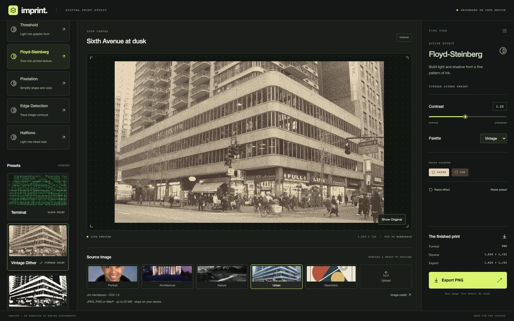

# Imprint

A browser-based digital print studio that turns photographs into pixel, ink, dot, and character patterns.

Planned live demo: [seatea-dev.github.io/effect-lab](https://seatea-dev.github.io/effect-lab/). Publication is pending approval; this link is not yet verified live.

## Preview



## Features

- Six effects: Terminal ASCII, Floyd-Steinberg dithering, Threshold, Pixelation, Edge Detection, and Halftone.
- Six curated presets and five bundled sample images.
- JPEG, PNG, and WebP uploads up to 20,000,000 bytes. Images stay on your device.
- Live parameter controls, independent effect settings, and separate effect and preset resets.
- Hold-to-Compare with pointer, Space, or Enter input.
- Opaque PNG export at source dimensions, with proportional downscaling above 12 megapixels.

## Tech stack

React, TypeScript, Vite, Tailwind CSS, Lucide React, and Vitest. Image processing uses Canvas, OffscreenCanvas, ImageBitmap, and a Web Worker.

## How it works

A dedicated worker decodes and prepares each source, then processes an analysis image with a maximum 1200-pixel edge. The main thread displays accepted original and processed images. Request revisions prevent obsolete results from replacing newer selections.

Pixelation, Halftone, and Terminal ASCII draw the same analyzed geometry at preview and export sizes. The other effects scale the processed raster without smoothing. Export does not recover photographic detail beyond the analysis image. Comparison changes only the displayed image, so it does not rerender effects or change the PNG.

## Getting started

Use Node.js 24 or newer and npm. CI uses Node.js 24.

```sh
git clone https://github.com/seatea-dev/effect-lab.git
cd effect-lab
npm ci
npm run dev
```

Open the Vite URL with the `/effect-lab/` path. The repository requires access until its visibility changes to public.

```sh
npm run build
npm run preview
```

No API keys, environment variables, accounts, or backend services are required by the application.

## Testing

```sh
npm run typecheck
npm run lint
npm test
npm run build
git diff --check
npm run test:gallery-browser
```

The gallery regression uses an installed Google Chrome and tests real pointer input at three desktop sizes, resets, source preservation, and PNG signature and header dimensions. Run it after the build. Set `CHROME_BIN` if Chrome is installed elsewhere.

The live-region regression needs Chrome and a separately installed Playwright package. Set `PLAYWRIGHT_NODE_MODULES` to the directory containing that installation, start the production preview in another terminal, then run:

```sh
NODE_PATH="$PLAYWRIGHT_NODE_MODULES" BASE_URL=http://127.0.0.1:4173/effect-lab/ node tests/browser/live-region.mjs
```

Vitest covers algorithms, definitions, session transitions, image sizing, cancellation, and worker/controller responses. [Release verification](docs/ticket-10-verification.md) records additional browser checks of actual decoded PNG pixels.

## Browser support

Chrome 154 is independently verified. Safari, Edge, and Firefox remain unverified. The application checks required worker and canvas capabilities at startup.

## Known limitations

- The desktop layout has a minimum width of 1100 pixels. Mobile editing is outside the current scope.
- Blueprint and Newsprint exceeded the 200 ms preview engineering target in recorded tests. Their reported medians were 237.7 ms and 208.1 ms. Results depend on image, settings, and machine; this target is not a response-time guarantee.
- PNG export is capped at 12 megapixels. Metadata and photographic detail beyond the analysis resolution are not preserved.

## Credits and license

[Asset credits](docs/assets.md) list image sources, redistribution terms, thumbnail modifications, and the IBM Plex Mono glyph atlas license. Imprint uses local system fonts for its interface.

No application source-code license has been selected. Making the repository public does not grant a general license to reuse the code. Bundled assets retain their documented licenses.

## Deployment

GitHub Actions checks pull requests and main. The prepared Pages workflow deploys only a successful main build after the repository is public and its publication gate is enabled. Publication remains disabled during preparation.

See [public-release preparation](docs/public-release.md) for the approval gates, Pages settings, and verification steps.
