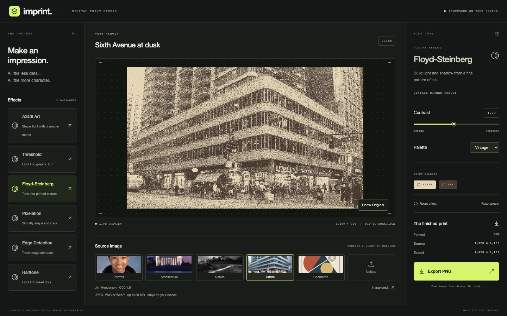
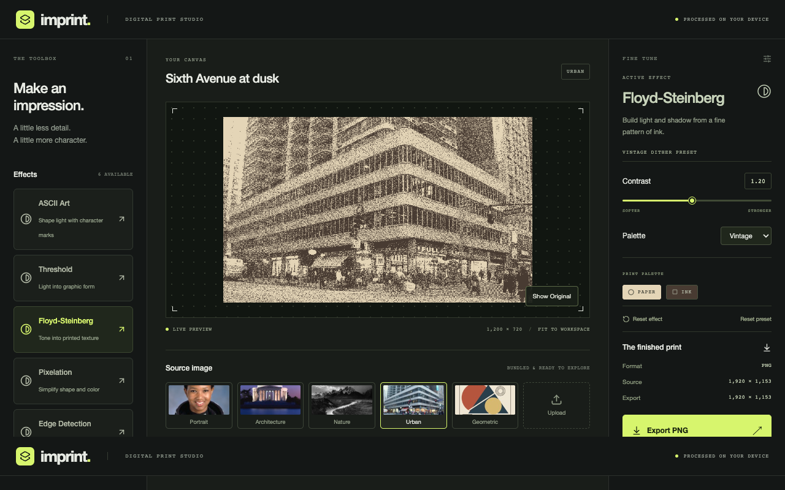

# Ticket 10: release readiness verification

## Scope and status

This closeout review covers the complete Imprint application on `feature/10-release-readiness`, based on `ac75c4331d8b730d34434b90e137a350767620a6`. The only application-code change uses indexed Sobel sampling while retaining the original normalized `Math.hypot` threshold comparison. Effect definitions, palettes, preset values, output sizing, upload policy, and worker/controller design remain unchanged.

## Automated checks

| Check | Result |
| --- | --- |
| `npm run typecheck` | Passed |
| `npm run lint` | Passed |
| `npm test` | Passed; 125 tests across 13 files |
| `npm run build` | Passed; production assets emitted with `/effect-lab/` base |
| `npm run test:gallery-browser` | Passed; pointer access, resets, source preservation, PNG signature, and dimensions read from the PNG header at the documented desktop sizes. It does not decode export pixels. |
| `BASE_URL=http://127.0.0.1:4193/effect-lab/ NODE_PATH="$PLAYWRIGHT_NODE_MODULES" node tests/browser/live-region.mjs` | Passed in Chrome; source-only live-region announcements remained stable through effects and errors |
| `git diff --check` | Passed |

GitHub Actions on the latest `main` commit (`ac75c433`) completed successfully. The repository is still private and `main` remains the default branch. In `.github/workflows/ci.yml`, both the Pages artifact and deploy jobs have `if: ${{ false }}`. No PR or main build can publish while those jobs are disabled; a live failing-check deployment test was not run because deployment is intentionally unavailable.

## Chrome production audit

The Vite production build was served at `http://127.0.0.1:4193/effect-lab/` in Google Chrome 154.0.8037.99 on a Mac mini with Apple M6, 24 GB memory, running macOS 27.0. The browser viewport was 1440 × 900 unless stated otherwise. The audit loaded the app under the repository subpath and exercised the real module worker, bundled thumbnails, sample images, Terminal atlas, and PNG downloads. It recorded no page errors, failed requests, or HTTP error responses.

The audit exercised all five samples and all six presets, then selected each effect directly. It changed every effect's principal controls, confirmed the Modified state, and used Reset Preset to restore captured values. It also checked the separate Reset Effect behavior, settings retention, and source preservation. The gallery regression uses real pointer input and reached all six cards by scrolling at 1440 × 900, 1280 × 800, and 1100 × 800.

The upload flow accepted a transparent 64 × 48 PNG, composited it to an opaque preview and export, replaced it with another upload, and rejected a corrupt PNG while retaining the usable source. Space and Enter showed the original only while held and restored the processed canvas on release. The audit checked labeled controls, keyboard-visible focus, and reduced-motion CSS. A worker was made to throw an uncaught error; Retry created a replacement worker and restored the selected sample. Starting a 12-megapixel export and switching sources canceled the export, showed the cancellation notice, and did not start a download.

### Layout evidence

At 1280 × 800, the preset list had a 464-pixel scroll viewport and 932 pixels of content. The preview remained visible, the export button ended at y=729, and the document had no horizontal overflow. At 1100 × 800, the three-column layout fit the viewport and the preset list remained scrollable. Widths below the 1100-pixel desktop minimum are outside the mobile support scope and may require horizontal scrolling.

### Preview responsiveness

For each sample, the audit measured one application of each preset after the source had settled. Timing began in the page immediately before the pointer click and ended in a `MutationObserver` when `.preview-stage[aria-busy]` returned to false. Five observations per preset are summarized below. The source dimensions are the bundled image dimensions; analysis uses a maximum 1200-pixel edge.

| Preset / effect | Median | Worst of five | Against 200 ms target |
| --- | ---: | ---: | --- |
| Terminal / ASCII Art | 103.0 ms | 109.6 ms | Within |
| Vintage Dither / Floyd-Steinberg | 115.1 ms | 126.3 ms | Within |
| Ink / Threshold | 110.8 ms | 122.0 ms | Within |
| Mosaic / Pixelation | 87.0 ms | 95.6 ms | Within |
| Blueprint / Edge Detection | 237.7 ms | 268.7 ms | Exceeded |
| Newsprint / Halftone | 208.1 ms | 214.4 ms | Exceeded |

| Sample | Source dimensions |
| --- | ---: |
| Sixth Avenue at dusk | 1920 × 1153 |
| Mae Jemison | 1536 × 1920 |
| Jefferson Memorial at dusk | 1920 × 1540 |
| The Tetons and the Snake River | 1920 × 1537 |
| Circles in balance | 1920 × 1440 |

These measurements are one five-sample pass. Blueprint's row was refreshed after the threshold correction; the other rows retain the initial closeout pass. This is a separate run, not a controlled before-and-after benchmark. Blueprint and Newsprint exceed the 200 ms target in the recorded passes. The results do not establish a device-independent guarantee, and no broader performance policy or architecture change was made.

The timing audit used a temporary Playwright harness from the existing local browser tooling rather than adding a package dependency. Reproduce the matrix by building and serving the production app under `/effect-lab/`, using Chrome at 1440 × 900, selecting each sample, and recording pointer-click to `aria-busy=false` for each preset. Repeat the five-sample matrix three times; report medians and maxima rather than one unusually fast render.

### 12-megapixel exports

The Chrome audit uploaded a generated opaque 4000 × 3000 PNG (12,000,000 pixels) and a 4200 × 3000 PNG (12,600,000 pixels). It measured from export click until the app reported download completion.

| Input | Export time | Actual PNG dimensions | PNG size | Result |
| --- | ---: | ---: | ---: | --- |
| 4000 × 3000 | 107 ms | 4000 × 3000 | 265,629 bytes | Kept original size |
| 4200 × 3000 | 111 ms | 4098 × 2927 | 267,491 bytes | Downscaled to 11,994,846 pixels; aspect ratio retained and notice shown |

Both files had a valid PNG signature, varied processed RGB samples, and zero non-opaque pixels across the entire decoded output. During the 12-megapixel export, the browser observed no main-thread long tasks; the maximum animation-frame gap was 16.7 ms over 12 frames. The over-cap UI displayed `4098 × 2927` before download.

### Resource lifecycle

The browser audit exercised multiple upload replacements, a failed upload, repeated renders, three successful exports, one canceled export, worker failure/retry, and page reload. The page created 12 object URLs and explicitly revoked 10. The two still-active URLs at the end belonged to the one retained upload and its thumbnail, which must remain available until the visit ends. Download URLs and replaced/failed upload URLs were revoked. The worker wrapper observed two workers created and one terminated before reload: Retry disposed the failed instance and left one active worker for the current session. Reload returned to the fresh default sample without retaining upload state; the browser then destroyed the old page realm.

## Independent review follow-up

Sol found a P2 threshold-boundary regression in the squared-gradient comparison. The supplied 3 × 3 opaque grayscale fixture produced `gx = gy = 510`. Its normalized magnitude is exactly `0.5`, but squaring the scaled threshold rounded it to `520200.00000000006` while the gradient square was `520200`. At 50 sensitivity the incorrect comparison returned Blueprint paper instead of ink. The processor now keeps indexed neighbor sampling and uses the original normalized `Math.hypot` comparison. The focused test was observed failing before the fix and passing afterward. It checks this fixture at every supported sensitivity from 0 through 100, with an explicit 50 sensitivity assertion. The existing full-frame differential test also compares every sensitivity against the original reference calculation.

An additional differential run compared the indexed implementation against the original processor for 8,080 combinations across 40 generated image sizes, all sensitivities, and both inversion settings. It found no output differences. The Vitest suite continues to cover borders, row batching, opacity, immutability, and repeatable output.

In Chrome 154, the production build at `/effect-lab/` accepted the supplied 3 × 3 PNG upload. At sensitivity 50, the preview center decoded as `[188, 235, 255, 255]`. The exported 3 × 3 PNG decoded to the same center pixel and had zero transparent pixels. The pointer-based gallery regression also passed at 1440 × 900, 1280 × 800, and 1100 × 800.

Sol also found that the README overstated `test:gallery-browser`: it checks the PNG signature and reads dimensions from the PNG header, but does not decode pixels. The README and this record now state that precisely. The separate release audit and exact-boundary Chrome check decode exported PNGs.

## Safari and other engines

Safari 27.0 is installed, but it could not be tested through this session. The computer-use surface could not attach to a Safari window (`cgWindowNotFound`), Safari WebDriver enablement required an administrator password, and Apple Events did not return a tab. No Safari interaction or compatibility result is claimed. Edge and Firefox were not tested. Chrome is the only engine verified in this record.

## Known limitations and remaining findings

- The measured worst-case Blueprint and Newsprint previews exceed the specification's 200 ms target on this machine. Their reported medians are near or just above the target. The results vary by run, and the target is a measured engineering goal rather than a device-independent guarantee.
- Safari, Edge, and Firefox remain unverified and are not claimed as supported by this release evidence.
- The desktop layout has a 1100-pixel minimum width; mobile-specific editing remains out of scope.
- The 12-megapixel export limit remains a provisional performance policy.
- GitHub Pages remains disabled. The private repository and deployment configuration were left unchanged.

No blocking functional regression was reproduced in Chrome. This record is for independent Sol review; it does not authorize a commit, push, pull request, merge, Pages enablement, or publication.
